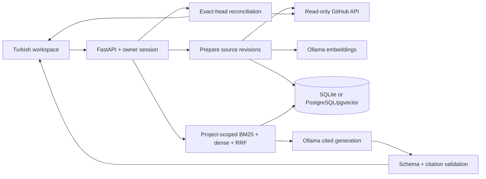

# Architecture

## Boundaries

`domain/` contains immutable objects, provider protocols, vector math and deterministic CI reconciliation without HTTP/ORM/model dependencies. `application/` owns ingestion preparation, retrieval and answer orchestration. `adapters/` supplies SQL, fixed-origin GitHub and Ollama contracts. `web/` composes these and applies owner authentication and presentation.

One process is intentional for personal use. Slow operations occupy at most two slots; synchronous FastAPI handlers run outside the event loop. No database connection is held while calling model APIs.

## SOLID

- Single responsibility: revision persistence, retrieval, transport and citation validation are separate modules.
- Open/closed: replace an embedder/generator through its protocol without rewriting the use case.
- Liskov: SQLite/PostgreSQL share memory contract tests; embedders return a named space and one finite vector per input.
- Interface segregation: embedding and generation are separate protocols even though Ollama implements both.
- Dependency inversion: use cases accept domain ports; HTTP composition selects adapters.

## Persistence

Projects contain stable sources, sources contain immutable revisions, and revisions contain derived search chunks. New revisions atomically deactivate old ones. Known revisions must match their content hash. Source deletion cascades through history and chunks. Repository imports prepare all content/embeddings before one transactional replacement; a bad revision rolls back the entire batch. Personal notes are outside repository reconciliation.

SQLite uses WAL, foreign keys, a busy timeout and a process-local writer lock. PostgreSQL uses per-project transaction-scoped advisory locks and native pgvector cosine. The supported deployment has one web worker; horizontal scaling requires shared throttling and transactional quotas. `metadata.create_all` is repeatable v1 schema bootstrap, not an upgrade migration framework. Future schema changes require explicit migrations and backup rehearsal.

## Retrieval

Paragraph-aware chunks have a hard 1,200-character limit. Turkish-normalized BM25 and model-digest-scoped dense search contribute up to 20 candidates each; reciprocal-rank fusion selects five. Vector dimensions must match. The configurable BGE-M3 cutoff was calibrated on different questions from the fixed regression benchmark.

This exact-search design targets a bounded personal corpus; lexical ranking loads active chunks and does not claim enterprise-scale search performance. HNSW, a search engine or cross-encoder should follow larger-corpus evidence.

Models see `S1`-style IDs; the app maps these to stored chunk IDs and rejects unknown citations. This validates identity, not entailment. Source text never grants execution authority, and there are no model execution tools.

## Live facts

Resolve the public repository's default branch and commit, then reconcile only runs at that SHA against configured workflow names. Missing/skipped/cancelled runs cannot become success. Historical failure counts cover only the API page examined. The UI shows the SHA and query time; a later push can make that snapshot old. CI success is not described as a production deployment.
